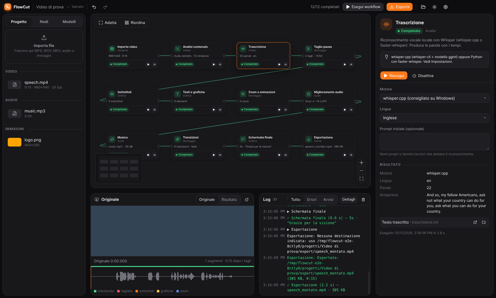
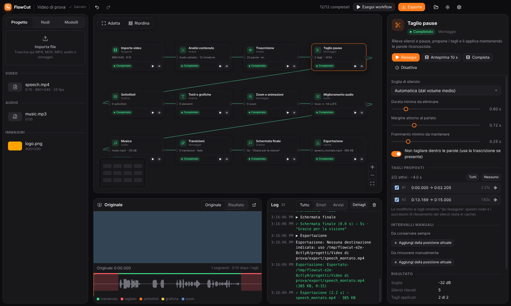
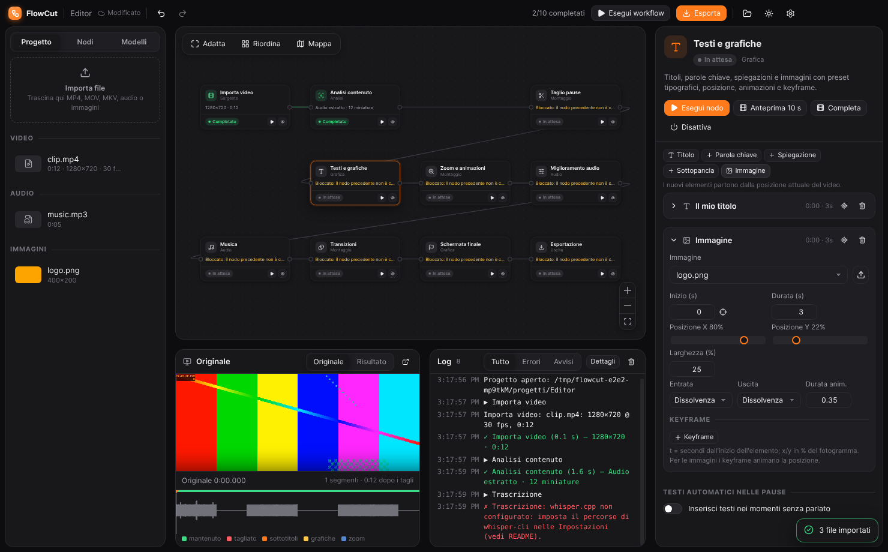
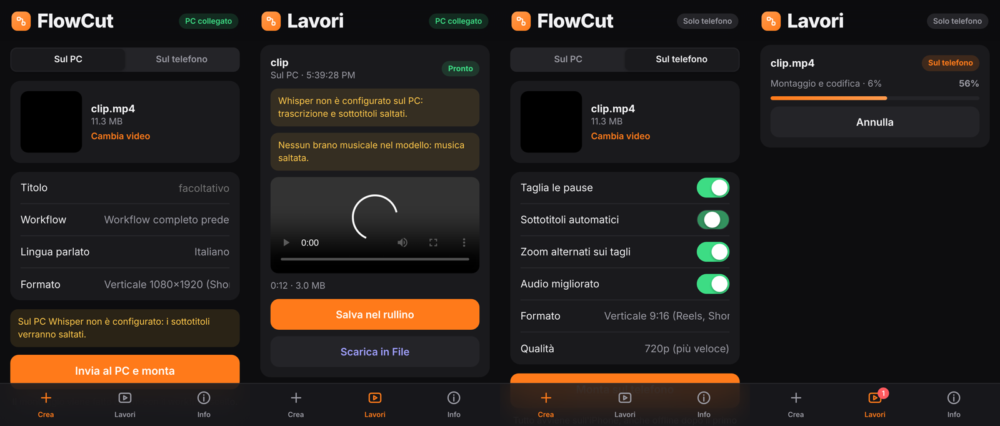
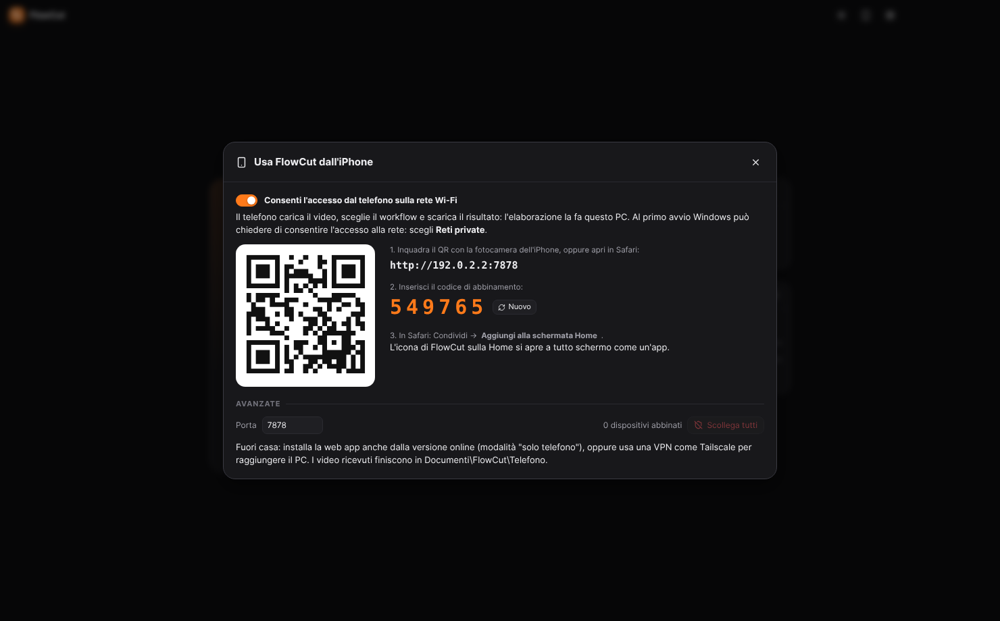
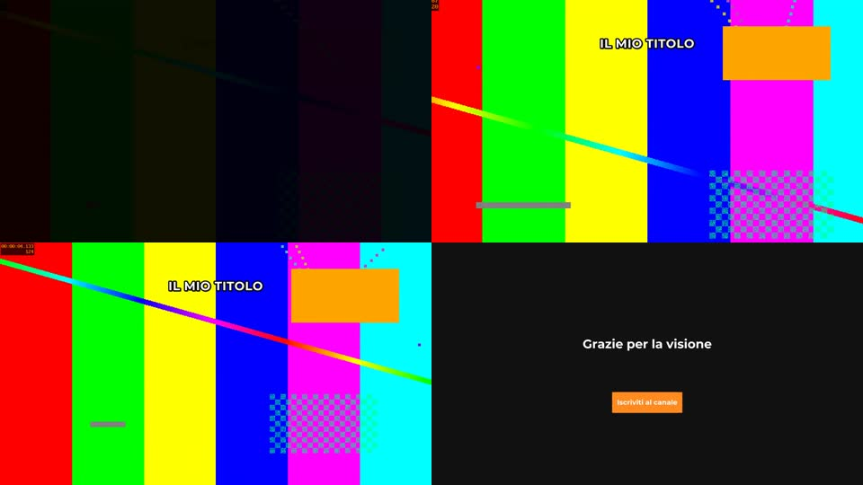

# FlowCut

Applicazione desktop per **automatizzare il montaggio video** (YouTube, video essay, tutorial, contenuti verticali) con un **workflow visuale a nodi**. Ogni nodo è un'operazione di montaggio reale eseguita in locale con FFmpeg e Whisper: niente servizi cloud a pagamento e il video originale non viene mai modificato.



```
Importa video → Analisi → Trascrizione → Taglio pause → Sottotitoli → Testi e grafiche
→ Zoom e animazioni → Miglioramento audio → Musica → Transizioni → Schermata finale → Esportazione
```

Si usa su **Windows** e anche su **iPhone**, come web app installabile da Safari senza App Store ([sezione 6](#6-usare-flowcut-dalliphone)).

Il codice si trova nella cartella [`app/`](app). Architettura e scelte tecniche sono in [`docs/ARCHITETTURA.md`](docs/ARCHITETTURA.md).

---

## Indice

1. [Installazione su Windows](#1-installazione-su-windows)
2. [Configurare la trascrizione (Whisper)](#2-configurare-la-trascrizione-whisper)
3. [Guida rapida](#3-guida-rapida)
4. [I nodi](#4-i-nodi)
5. [Workflow riutilizzabili](#5-workflow-riutilizzabili)
6. [Usare FlowCut dall'iPhone](#6-usare-flowcut-dalliphone)
7. [Stato del progetto: cosa funziona e cosa manca](#7-stato-del-progetto-cosa-funziona-e-cosa-manca)
8. [Sviluppo e test](#8-sviluppo-e-test)
9. [Risoluzione dei problemi](#9-risoluzione-dei-problemi)
10. [Licenze](#10-licenze)

---

## 1. Installazione su Windows

Requisiti: Windows 10/11 a 64 bit e una connessione a Internet per il primo download.

### Installazione automatica (consigliata)

Basta **un solo file**: scarica [`INSTALLA-FLOWCUT.bat`](INSTALLA-FLOWCUT.bat) (pulsante *Download raw file* su GitHub), mettilo dove vuoi e fai doppio clic. Il codice di FlowCut viene scaricato automaticamente in `%LOCALAPPDATA%\FlowCut\sorgente`.

In alternativa scarica tutto il repository (**Code → Download ZIP**), estrailo e fai doppio clic su `INSTALLA-FLOWCUT.bat` nella cartella principale.

Lo script fa tutto da solo:

| Passaggio | Cosa installa |
| --- | --- |
| 0 | Il **codice di FlowCut** da GitHub (solo se il .bat è da solo) |
| 1 | **Node.js LTS**, se manca (con winget o con l'installer ufficiale) |
| 2 | Dipendenze dell'app, compreso **FFmpeg** per Windows |
| 3 | **whisper.cpp** (ultima release ufficiale) in `%LOCALAPPDATA%\FlowCut\whisper` |
| 4 | Il **modello Whisper** che scegli (base, small o large-v3-turbo) in `%APPDATA%\FlowCut\models` |
| 4b | **Piper** e la voce italiana "Paola" per la voce narrante (`-SenzaVoce` per saltarli) |
| 5 | Le **impostazioni** dell'app, già configurate per la trascrizione |
| 6 | L'**installabile** `FlowCut-Setup-x.y.z.exe`, poi l'installazione di FlowCut con collegamento sul desktop e nel menu Start |

Al termine FlowCut si avvia già pronto, trascrizione compresa. Se qualcosa va storto (ad esempio cade la connessione), rilancia lo script: i passaggi già completati vengono saltati.

Opzioni avanzate (da riga di comando): `INSTALLA-FLOWCUT.bat -Modello large-v3-turbo-q5_0`, `-SenzaWhisper`, `-SenzaInstallabile` (usa l'app senza installarla), `-NonInterattivo`.

Le opzioni che seguono servono solo se preferisci procedere a mano. Richiedono **Node.js 20 o superiore** ([nodejs.org](https://nodejs.org), versione LTS).

### Opzione A — avvio diretto dal codice

1. Scarica il repository (pulsante **Code → Download ZIP** su GitHub) ed estrailo.
2. Apri la cartella `app` e fai doppio clic su **`avvia-windows.bat`**.
   Al primo avvio installa le dipendenze (qualche minuto, scarica anche FFmpeg per Windows); dalle volte successive parte subito.

### Opzione B — creare l'installabile `.exe`

- Doppio clic su **`app/crea-installer-windows.bat`**. Al termine si apre la cartella `app/dist` con `FlowCut-Setup-0.1.0.exe`.
- In alternativa, da terminale: `cd app`, `npm install`, `npm run dist:win`.
- In alternativa, su GitHub: scheda **Actions → Installabile Windows → Run workflow**. Al termine scarichi l'installabile dagli artefatti. Il workflow è in `.github/workflows/windows-installer.yml` e parte automaticamente anche a ogni push su `main`.

> Crea l'installabile **su Windows** (o con la GitHub Action): durante `npm install` viene scaricato il binario FFmpeg del sistema operativo in uso.

L'installabile include già FFmpeg, FFprobe e i font. Non servono altri programmi, a parte Whisper per la trascrizione.

La build Windows è verificata su GitHub Actions (`windows-latest`): test con FFmpeg reale, creazione dell'installabile, esecuzione di `INSTALLA-FLOWCUT.bat`, installazione silenziosa e trascrizione reale con whisper.cpp.

## 2. Configurare la trascrizione (Whisper)

Se hai usato `INSTALLA-FLOWCUT.bat` è già configurata e puoi saltare questa sezione.

La trascrizione serve ai nodi **Trascrizione** e **Sottotitoli** (e, se presente, a "Taglio pause" per non tagliare dentro le parole). Avviene sul tuo PC.

### whisper.cpp (consigliato, nessun Python richiesto)

1. Scarica lo zip per Windows dalle [release di whisper.cpp](https://github.com/ggml-org/whisper.cpp/releases):
   - `whisper-bin-x64.zip` → funziona su qualsiasi CPU;
   - `whisper-cublas-…-bin-x64.zip` → più veloce con una scheda NVIDIA.
2. Estrailo, ad esempio, in `C:\whisper`.
3. In FlowCut apri **Impostazioni** (icona ingranaggio) → *Eseguibile whisper-cli* → seleziona `C:\whisper\whisper-cli.exe`.
4. Nella stessa finestra scarica un modello con il pulsante **Scarica**. Consigliati: `small` (466 MB, buon compromesso) oppure `large-v3-turbo-q5_0` (547 MB, qualità molto alta). Il modello scaricato viene impostato automaticamente.
5. Premi **Salva e verifica**: i due indicatori devono diventare verdi.

FlowCut usa l'allineamento DTW di whisper.cpp per ottenere tempi precisi parola per parola. Serve un modello con il nome originale (`ggml-<nome>.bin`), come quelli scaricati dall'app.

### faster-whisper (alternativa Python)

1. Installa Python 3.9+ ed esegui `pip install faster-whisper`.
2. Nel nodo **Trascrizione** scegli *Motore: faster-whisper* e il modello (`small`, `medium`, …). Il modello viene scaricato automaticamente al primo uso.
3. Se `python` non è nel PATH, indica l'interprete in Impostazioni.

## 3. Guida rapida

1. **Nuovo progetto** → nome e cartella. Viene creata una cartella con `project.flowcut.json` e la sottocartella `work` (tutti i file intermedi).
2. **Importa il video** trascinandolo nell'area *Progetto* (MP4, MOV, MKV, WEBM, AVI, MTS…). Il primo video importato viene collegato automaticamente al nodo *Importa video*, il primo brano audio al nodo *Musica*.
3. Premi **Esegui workflow** (o `Ctrl+Invio`). I nodi si colorano mentre vengono eseguiti; il log mostra ogni passaggio.
4. Seleziona un nodo per vederne impostazioni e **risultato**. Ad esempio, in *Taglio pause* trovi l'elenco dei tagli proposti, che puoi escludere uno per uno.
5. Usa **Anteprima 10 s** (dalla posizione attuale del video) o **Completa** per vedere il risultato fino a quel nodo, a bassa risoluzione.
6. Premi **Esporta**. Se non hai scelto una destinazione, il video va in `<progetto>/export/<nome>_montato.mp4` insieme al file `.srt`.

Quando modifichi un'impostazione, il nodo e quelli successivi diventano **"Da rieseguire"**: alla prossima esecuzione vengono rielaborati solo loro, gli altri restano in cache.

**Comandi del workflow:** trascina i nodi dalla scheda *Nodi* oppure fai clic per inserirli dopo il nodo selezionato; collega le maniglie a destra e a sinistra; usa il tasto destro per *Esegui*, *Forza riesecuzione*, *Sposta prima/dopo*, *Duplica*, *Disattiva*, *Elimina*. Eliminando un nodo in mezzo alla catena, i nodi vicini vengono ricollegati.

**Scorciatoie:** `Ctrl+Z` annulla · `Ctrl+Y` / `Ctrl+Shift+Z` ripeti · `Ctrl+D` duplica · `Canc` elimina · `Ctrl+S` salva · `Ctrl+Invio` esegui tutto.

**Timeline sotto l'anteprima:** forma d'onda, parti mantenute (verde) e tagliate (rosso), sottotitoli, grafiche, zoom e cambi scena. Un clic sposta il video in quel punto. I pulsanti ⌖ nei pannelli inseriscono la posizione attuale del video nei campi tempo.



## 4. I nodi

Ogni nodo esegue una funzione reale. Nessun nodo è dimostrativo.

| Nodo | Cosa fa (implementazione) |
| --- | --- |
| **Importa video** | Legge i metadati con ffprobe (durata, risoluzione, fps, codec, audio, rotazione), crea un fotogramma di copertina e, se il formato non è riproducibile nell'app (es. HEVC, ProRes), un **proxy** 720p usato solo per l'anteprima. |
| **Analisi contenuto** | Estrae l'audio (WAV 16 kHz), calcola forma d'onda, volume medio/picco e loudness EBU R128, genera le miniature e, se richiesto, rileva i cambi scena. |
| **Trascrizione** | Whisper locale (whisper.cpp con DTW oppure faster-whisper): parole con tempi precisi, lingua scelta o rilevata automaticamente, prompt iniziale per nomi propri. |
| **Voce narrante** | Genera una voce parlata dal **testo che scrivi** (una frase per riga, con tempo di inizio facoltativo, es. `0:20 Ora vediamo…`), con **Piper**: sintesi vocale locale e gratuita, con voci italiane, inglesi, spagnole, francesi e tedesche. Scegli voce e velocità. L'audio originale può essere mantenuto, abbassato mentre la voce parla o tolto. Dallo stesso testo crea anche i **sottotitoli**: il nodo Trascrizione viene saltato e Whisper non serve. Le parti con la voce non vengono mai tagliate da "Taglio pause". |
| **Taglio pause** | `silencedetect` con soglia automatica (dal volume medio) o manuale, durata minima, margine attorno al parlato, frammento minimo. Non taglia mai dentro le parole trascritte. Offre l'elenco dei tagli con esclusione singola, intervalli da conservare sempre e intervalli da rimuovere a mano. |
| **Sottotitoli** | Raggruppa le parole in sottotitoli leggibili, con testo e tempi modificabili e ripristino. Stile: font, dimensione, colori, contorno, ombra, riquadro, posizione, maiuscolo. Animazioni: dissolvenza, pop, parola attiva evidenziata, karaoke, una parola alla volta. Parole chiave evidenziate (con suggerimenti dalle parole più frequenti). Esporta l'SRT e li incide nel video. |
| **Testi e grafiche** | Titoli, parole chiave, spiegazioni, sottopancia e immagini. 5 preset tipografici, posizione, durata, colore, animazioni di entrata/uscita (dissolvenza, scorrimento, pop, macchina da scrivere) e **keyframe** di posizione, scala e opacità. Può anche inserire automaticamente testi nelle pause del parlato. |
| **Zoom e animazioni** | Zoom automatici alternati sui tagli (punch-in) o sulle parole chiave, zoom manuali su intervalli, preset riutilizzabili (anche personali) e **keyframe di inquadratura** (scala + centro) interpolati. Opzione qualità alta per uno zoom più fluido. |
| **Miglioramento audio** | Passa-alto, riduzione rumore FFT (`afftdn`), de-esser, compressore, volume voce e **normalizzazione loudness a due passate** (misura reale, poi `loudnorm` lineare) a −14/−16/−23 LUFS. Pulsante **Ascolta A/B** (originale vs elaborato). |
| **Musica** | Brano di sottofondo con volume, fade-in/out, loop, punto di inizio e **ducking automatico** (`sidechaincompress`) durante il parlato. Può continuare sulla schermata finale. |
| **Transizioni** | `xfade`/`acrossfade` (17 tipi) su tutti i tagli, un taglio ogni N, solo i tagli con pausa lunga, oppure solo i tagli scelti dall'elenco. Durata regolabile, dissolvenza iniziale dal nero e finale al nero. |
| **Schermata finale** | Sfondo a tinta unita o immagine, titolo, sottotitolo, invito all'azione con riquadro colorato, logo, dissolvenza dal video. |
| **Esportazione** | MP4/MOV/MKV con H.264 (x264), H.265 (x265) o encoder GPU (NVENC, Quick Sync, AMF, se disponibili e funzionanti). Risoluzione (incluse 1080×1920 verticale e 1080×1080), adattamento (sfondo sfocato, ritaglio, bande nere), fps, qualità, velocità, bitrate audio. Avanzamento reale con tempo stimato, annullabile, SRT accanto al video. |

Puoi disattivare un nodo senza eliminarlo (**Disattiva**): viene attraversato senza modifiche. Puoi anche creare diramazioni, ad esempio due nodi *Esportazione* (orizzontale e verticale) collegati allo stesso nodo.



## 5. Workflow riutilizzabili

Nella scheda **Modelli** salvi il workflow corrente (nodi, collegamenti e impostazioni) come modello. I riferimenti ai file del progetto vengono esclusi automaticamente. Puoi applicare un modello a un altro progetto, sceglierlo alla creazione di un nuovo progetto ed esportarlo/importarlo come file `.json` per condividerlo o fare backup.

Il flusso tipico per i tuoi video YouTube:
1. imposta una volta il workflow (stile dei sottotitoli, zoom, musica, schermata finale, esportazione);
2. salvalo come modello;
3. a ogni nuovo video: *Nuovo progetto* con quel modello → trascina il video → **Esegui workflow** → controlla tagli e sottotitoli → **Esporta**.

## 6. Usare FlowCut dall'iPhone

FlowCut si usa anche su iPhone come **web app installabile da Safari**, senza App Store: si aggiunge alla schermata Home e si apre a tutto schermo come un'app. Funziona in due modi, scegli nella scheda *Crea*.



### Modalità "Sul PC" (consigliata)

L'iPhone fa da telecomando: carichi un video dal rullino, scegli workflow, lingua e formato, e il PC fa il montaggio completo con tutte le funzioni. Puoi seguire l'avanzamento nodo per nodo e, a montaggio finito, salvare il video nel rullino.

1. Sul PC apri FlowCut e premi l'**icona del telefono** in alto a destra.
2. Attiva **Consenti l'accesso dal telefono**. Se Windows chiede il permesso di rete, scegli *Reti private*.
3. Sull'iPhone, collegato alla **stessa rete Wi-Fi**, inquadra il **codice QR** con la fotocamera (oppure apri in Safari l'indirizzo mostrato, es. `http://192.168.1.20:7878`).
4. Inserisci il **codice di abbinamento** a 6 cifre. Il codice vale una sola volta; l'iPhone resta abbinato finché non lo scolleghi.
5. In Safari tocca **Condividi → Aggiungi alla schermata Home**.



Come funziona:
- I video ricevuti diventano progetti in `Documenti\FlowCut\Telefono` e restano consultabili anche dal PC.
- Senza un brano nel modello, il nodo Musica viene saltato.
- Senza Whisper configurato sul PC, trascrizione e sottotitoli vengono saltati, con un avviso sul telefono.
- **Sicurezza:** le API rispondono solo ai dispositivi abbinati. Dal pannello puoi generare un nuovo codice o scollegare tutti i telefoni.
- **Fuori casa:** il PC si raggiunge con una VPN come [Tailscale](https://tailscale.com) (gratuita), usando l'indirizzo Tailscale del PC.

### Modalità "Sul telefono" (senza PC)

Il montaggio avviene **interamente sull'iPhone**, anche offline dopo il primo utilizzo. Usa FFmpeg in WebAssembly e Whisper tramite transformers.js, con lo **stesso compilatore** della versione desktop.

Funzioni disponibili:
- taglio automatico delle pause, senza tagliare dentro le parole;
- sottotitoli automatici con la parola attiva evidenziata;
- zoom alternati sui tagli;
- audio migliorato (filtro passa-alto, riduzione rumore, compressore, loudness −14 LUFS);
- formato originale o verticale 9:16, in 720p o 1080p.

Al primo uso dei sottotitoli il modello Whisper viene scaricato da Hugging Face (tiny ≈ 40 MB, base ≈ 80 MB, small ≈ 250 MB) e poi resta in memoria.

Per usarla senza il PC, la web app va installata da un indirizzo **HTTPS** (requisito di Safari per l'uso offline). Il repository contiene la GitHub Action `web-app-iphone.yml`, che la pubblica su **GitHub Pages**:

1. unisci il ramo in `main`;
2. su GitHub apri **Settings → Pages → Source: GitHub Actions** (una sola volta);
3. la web app sarà su `https://falconiriccardo5-hub.github.io/rikyfalco/`: aprila in Safari e aggiungila alla schermata Home.

La versione installata da GitHub Pages lavora solo sul telefono. Per la modalità PC apri l'indirizzo del PC: scheda *Crea → Sul PC*, dove puoi inserirlo e aprirlo.

> **Limiti della modalità telefono (iOS):** l'elaborazione è molto più lenta del PC ed è pensata per clip di pochi minuti. Tieni l'app aperta e lo schermo acceso. I video molto grandi possono superare la memoria disponibile per Safari. Per video lunghi, musica, testi, transizioni e schermata finale usa la modalità PC.

## 7. Stato del progetto: cosa funziona e cosa manca

### Verificato in questo ambiente (Linux, FFmpeg 7.0.2)

- **Test automatici** (`npm test`: 19 test, più 2 opzionali per Whisper e prestazioni): calcolo di tagli, layout, mappatura dei tempi, sottotitoli, hash e invalidazione, conversione dei token di Whisper. Più un'esecuzione completa con FFmpeg reale di tutti i nodi: taglio pause, sottotitoli, testi con keyframe, immagine, zoom, audio, musica, transizioni, schermata finale, esportazione. Sono verificati la durata del file, l'SRT, la cache, la riesecuzione selettiva, l'annullamento e i file mancanti.
- **Voce narrante con Piper reale**: voce generata dal testo, mescolata con l'audio originale abbassato (−18 dB mentre parla), sottotitoli creati dal testo. Installazione di Piper e download della voce dalle Impostazioni, provati nell'app reale.
- **Trascrizione reale con whisper.cpp** (modello `base.en`): testo corretto, tempi DTW, nessun taglio dentro le parole, sottotitoli incisi ed esportati.
- **Prestazioni:** un video 720p di 10 minuti con 300 segmenti e 11 transizioni viene esportato in circa 90 secondi, con la durata finale esatta (audio e video sincronizzati).
- **Interfaccia Electron reale** guidata con Playwright (`scripts/e2e-*.mjs`): creazione progetto, importazione, esecuzione di tutti i 12 nodi, errore e blocco dei nodi successivi, eliminazione con ricollegamento della catena, editor di testi/zoom/transizioni, esclusione di un taglio con stato "da rieseguire", annulla/ripeti, anteprime, esportazione, modelli, tema chiaro/scuro, download di un modello Whisper.
- **Pacchetto Linux** creato con electron-builder: l'app impacchettata trova FFmpeg e FFprobe inclusi.



- **Web app per iPhone**, testata in un browser con emulazione iPhone 14 (`tests/mobile.e2e.test.ts`):
  - modalità PC: abbinamento, caricamento, lavoro completo di 12 nodi, video 1080×1920 scaricato;
  - modalità telefono: video verticale 720×1280 con pause tagliate in circa 22 secondi;
  - Whisper nel browser: 23 parole trascritte, 4 sottotitoli incisi.

  A parte, sul server: abbinamento, token, caricamento e Range (`tests/remote.test.ts`); il pannello QR nell'app desktop reale.


### Non verificato qui (da provare sul tuo PC)

- **Esecuzione e installabile su Windows:** in questo ambiente non c'è Windows. Il codice gestisce i percorsi Windows (cartelle con spazi o accenti, unità diverse, `.exe`) e la configurazione NSIS è pronta, ma il primo avvio reale va fatto da te o tramite la GitHub Action.
- **Encoder GPU** (NVENC/QSV/AMF): non c'è una GPU in questo ambiente. L'app li verifica con una codifica di prova e li segnala se non funzionano.
- **faster-whisper:** lo script è incluso ma non è stato eseguito qui.
- **Safari su un iPhone vero:** i test usano Chromium con emulazione dell'iPhone, perché Safari/WebKit non è disponibile in questo ambiente. Su un iPhone reale vanno verificati la velocità della modalità telefono, i limiti di memoria di Safari e il salvataggio nel rullino tramite il foglio di condivisione.
- **GitHub Pages:** il workflow di pubblicazione è pronto, ma funziona solo dopo l'unione in `main` e l'attivazione di Pages nelle impostazioni del repository.

### Non ancora implementato / limitazioni note

- "Intensità" delle transizioni: è regolabile solo la durata.
- Le immagini supportano keyframe di posizione e dissolvenze, ma non animazioni di scala (per i testi la scala è supportata).
- Nessun posizionamento dei testi trascinandoli sul video: la posizione si imposta con i cursori in percentuale.
- La riduzione del rumore usa `afftdn` (FFT). RNNoise (`arnndn`) richiederebbe un modello aggiuntivo e non è collegato.
- Un workflow monta un solo video sorgente. Più clip vanno unite prima, oppure si possono usare più rami.
- Le parole chiave suggerite si basano sulla frequenza nel parlato, non su un modello AI.
- Lo zoom usa `zoompan`, che può avere un leggero tremolio sugli zoom lenti. L'opzione *Qualità alta* lo riduce, al costo di una codifica più lenta.

## 8. Sviluppo e test

```bash
cd app
npm install
npm run dev          # avvio con ricaricamento automatico
npm run typecheck    # controllo dei tipi
npm test             # test unitari e d'integrazione (FFmpeg reale)
npm run build        # compilazione in out/
npm run dist:win     # installabile Windows (da eseguire su Windows)
npm run dev:mobile   # web app iPhone in sviluppo (apri l'indirizzo di rete dal telefono)
npm run build:mobile # web app iPhone in out/mobile
```

Test opzionali:

```bash
# trascrizione reale (richiede whisper-cli e un modello)
WHISPER_CLI=/percorso/whisper-cli WHISPER_MODEL=/percorso/ggml-base.en.bin SPEECH_WAV=/percorso/jfk.wav npx vitest run tests/transcribe.test.ts
# web app iPhone in un browser con emulazione iPhone (dopo npm run build:mobile)
MOBILE_E2E=1 SPEECH_VIDEO=/percorso/video-parlato.mp4 npx vitest run tests/mobile.e2e.test.ts
# prestazioni su un video lungo
PERF=1 PERF_MINUTES=10 npx vitest run tests/perf.test.ts
# interfaccia end-to-end (dopo npm run build e npm test, che crea i media di prova; su Linux con xvfb-run)
node scripts/e2e-smoke.mjs e2e-shots
node scripts/e2e-editors.mjs e2e-shots
```

**Dove finiscono i dati:**
- progetto: `<cartella progetto>/project.flowcut.json`;
- file di lavoro: `<cartella progetto>/work/` (audio estratto, cache dei nodi, anteprime, `log.txt`). Si può cancellare per liberare spazio: verrà ricreato;
- impostazioni, modelli Whisper e modelli di workflow: `%APPDATA%\FlowCut\`.

## 9. Risoluzione dei problemi

| Problema | Soluzione |
| --- | --- |
| "whisper.cpp non configurato" | Vedi [sezione 2](#2-configurare-la-trascrizione-whisper). Senza trascrizione puoi eliminare o disattivare i nodi *Trascrizione* e *Sottotitoli*: il resto funziona. |
| Il video non si vede nell'anteprima | Formato non supportato da Chromium (es. HEVC/ProRes): esegui *Importa video*, che crea un proxy. |
| "File mancante" | Il file è stato spostato: nella scheda *Progetto* usa l'icona di collegamento per ricollegarlo. |
| Encoder GPU in errore | Aggiorna i driver oppure usa H.264 (x264). |
| Sottotitoli che non partono quando si parla | Usa un modello Whisper più grande, imposta la lingua corretta e verifica di usare un modello `ggml-*.bin` con il nome originale (serve per il DTW). |
| Il video non ha una voce | La trascrizione serve solo se nel video qualcuno parla. Per far parlare il video aggiungi il nodo **Voce narrante** (scheda *Nodi*), scrivi il testo e scegli la voce: i sottotitoli verranno creati dallo stesso testo. Se ti servono Piper o le voci: Impostazioni → *Voce narrante*. |
| "whisper.cpp terminato con errore" senza dettagli | Di solito mancano le librerie Microsoft Visual C++: installale da https://aka.ms/vs/17/release/vc_redist.x64.exe oppure rilancia `INSTALLA-FLOWCUT.bat`. Il messaggio dell'app ora indica la causa. |
| Esportazione lenta | Velocità di codifica `veryfast`/`faster`, un encoder GPU, oppure disattiva *Qualità alta* nello zoom. |

Ogni progetto ha un log completo in `work/log.txt`. Nell'app, il pulsante *Dettagli* del pannello Log mostra anche i comandi eseguiti.

## 10. Licenze

- Codice di FlowCut: MIT.
- FFmpeg (incluso tramite `ffmpeg-static`) è distribuito con licenza **GPL**: se ridistribuisci l'installabile, rispetta i termini della GPL (codice sorgente di FFmpeg disponibile su [ffmpeg.org](https://ffmpeg.org)).
- Font Montserrat e Inter: SIL Open Font License (file in `app/resources/fonts`).
- whisper.cpp (MIT) e i modelli Whisper (MIT, OpenAI) vengono scaricati separatamente.
