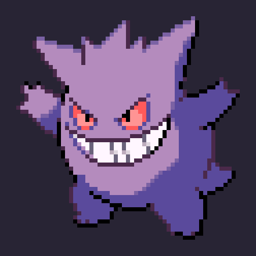

# Gengar — pixel sprite rebuild + idle animation

Figma: https://www.figma.com/design/n5MrjIat12Srmjez2eQBqz

## Analisi dello sprite
- Griglia **55×55 px**, scala 8× nell'immagine sorgente (1px = 8pt in Figma).
- Palette di **11 colori**, stile Gen 3: outline prugna `#4A294A` + outline nero `#000000` (dark-side),
  corpo in 3 toni (base `#B48BBD`, midtone `#7B62A4`, ombra `#5A4A9C`), luce dall'alto a sinistra,
  denti `#FFF6FF` con 3 toni di separazione, occhi `#FF9494` / `#FF5A5A`.
- Anatomia separata in 8 layer: `Eyes`, `Mouth`, `Arm L`, `Body`, `Foot L`, `Foot R`, `Tail`, `Arm R`
  (ordine dall'alto verso il basso), e in ogni layer un vettore per ruolo colore
  (Base, Midtone, Shadow, Outline, Outline Dark…). Ogni fill è legato alle variabili `Gengar Palette`.

## Animazione idle (come nel gioco)
4 frame, timing a step senza interpolazione:

| Frame | Corpo/testa | Braccio dx + coda | Braccio sx | Occhi | ms |
|---|---|---|---|---|---|
| 1 | 0 | 0 | 0 | aperti | 200 |
| 2 | +1px | 0 | −1px | aperti | 160 |
| 3 | +2px | +1px | 0 | aperti | 220 |
| 4 | +1px | +2px | +1px | **chiusi** | 160 |

Sequenza: `1 2 3 2 1 2 3 2 1 2 3 4` (il blink arriva una volta ogni 3 cicli).
Il braccio destro e la coda seguono il corpo con 1 frame di ritardo (overlapping action), i piedi restano fermi.

In Figma:
- **Component set `Gengar / Idle`**: varianti `Frame=1…4` con interazioni *After delay → Change to* (Instant) che fanno girare il loop da sole.
- **▶ Prototype Preview**: flow di partenza, premi Present.
- **🎬 Idle Motion (timeline)**: keyframe Motion `TRANSLATION_Y`/`OPACITY` con easing `HOLD` (2.22s), esportabile in MP4.

`build.py` rigenera GIF, sprite sheet e `gengar.json` (pixel run per layer/colore) da `grid.txt`.
