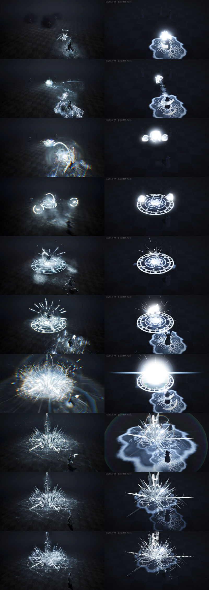

# Ice Ultimate VFX (Godot 4.3+)

Ricostruzione in Godot dell'abilità "ultimate" di ghiaccio del video di riferimento
(10 s, Unreal). Tutto è modificabile: scene `.tscn`, shader `.gdshader`, script `.gd`,
texture, coreografia (AnimationPlayer) e asset Blender (script Python in `blender/`).

Pipeline ibrida, come nei team VFX di produzione:
- **Blender**: flipbook volumetrici (fumo, esplosione, nube di gelo), mesh (nastri a
  spirale, mezzelune, cupola d'urto, spada, cristalli) e personaggio con scheletro e
  animazione di cast.
- **Godot**: regia (timeline), particelle, shader in tempo reale, camera e post-process.



`docs/confronto_riferimento.mp4` mostra il video originale e il render Godot affiancati.

## Avvio rapido

1. Apri Godot **4.3 o successivo**, poi *Import* e scegli `project.godot`.
2. Premi **F5**: la scena demo lancia l'effetto in loop. Con **Spazio** o un **click** lo rilanci.
3. Per usarlo nel tuo gioco, istanzia `scenes/ice_ultimate.tscn` **sul bersaglio**,
   imposta `caster_offset` (posizione di chi lancia, in coordinate locali) e chiama `play()`.

```gdscript
var ult := preload("res://scenes/ice_ultimate.tscn").instantiate()
target.add_child(ult)
ult.caster_offset = ult.to_local(caster.global_position)
ult.play()
ult.detonated.connect(func(): apply_damage())   # anche: impact, finished
```

Renderer consigliato: **Forward+**. Con **Compatibility** funziona tutto, ma
rifrazione dei cristalli e distorsione dell'onda d'urto sono più deboli. In quel caso
attiva `compatibility_depth` nei materiali del fumo per le soft particles corrette.

## Analisi dell'effetto (breakdown)

| Tempo | Fase | Cosa succede nel video | Modulo Godot |
|---|---|---|---|
| 0.0–0.5 s | Lock-on | Lampi rossi anamorfici sui 3 nemici | `TargetFlares` |
| 0.0–1.6 s | Cast | Fiocco di neve luminoso sul caster, brina "elettrica" a terra con crepe, vortici d'aria, scintille | `CastFrost` |
| 0.35–2.5 s | Proiettile | Sfera di ghiaccio con archi luminosi orbitanti e scia di neve, vola sul bersaglio e resta sospesa | `IceOrb` |
| 2.52 s | Impatto | Flash, anelli in espansione, fumo, fiocchi, aberrazione cromatica, camera shake | `ImpactBurst` + post FX |
| 2.6–3.95 s | Satelliti | Due bolle con anelli luminosi si aprono ai lati e poi rientrano | `RingOrbA/B` |
| 2.8–7.0 s | Sigillo | Cerchio magico (zodiaco cinese, esagramma, taiji) che si disegna dal centro e ruota, con nebbia, scie a ventaglio verso l'alto e scintille sul bordo | `MagicCircle` |
| 3.6–6.9 s | Carica | Bolla che cresce con nucleo scuro e mezzelune rotanti; il caster si ricarica (5.2 s) | `ChargeCore` + `CastFrost` |
| 6.87 s | Detonazione | Flash bianco enorme, loop luminosi, onda di gelo blu a terra, distorsione, detriti, blur radiale e aberrazione cromatica, shake forte | `Detonation` + post FX |
| 6.9–8.6 s | Cristalli | Esplosione di spuntoni di ghiaccio con overshoot, bracci a fiocco di neve, spada di ghiaccio che cala, crepe e luccichii | `CrystalEruption` |
| 8.6–9.7 s | Dissoluzione | I cristalli si dissolvono in polvere che sale | `CrystalEruption.dissolve` |

## Struttura

```
project.godot
blender/
  flipbooks.py           volumi procedurali Cycles -> sprite sheet 8x8 (textures/flipbooks/)
  meshes.py              mesh + personaggio animato -> models/*.glb
models/*.glb             export glTF da Blender
meshes/*.res             mesh estratte dai .glb (tools/extract_meshes.gd)
scenes/
  demo.tscn              scena di prova: ambiente, pavimento, manichini, camera, post FX
  ice_ultimate.tscn      ORCHESTRATORE: istanzia i moduli + AnimationPlayer "cast"
  vfx/*.tscn             un modulo per fase (vedi tabella)
scripts/
  ice_ultimate.gd        play(), segnali, eventi della timeline (shake, post, burst)
  vfx_module.gd          classe base dei moduli (parametri macro, burst())
  <modulo>.gd            parametri macro di ogni modulo (@tool: anteprima nell'editor)
  crystal_cluster.gd     generatore procedurale del cluster di cristalli (MultiMesh)
  camera_shake.gd        shake a "trauma" con rumore
  post_fx.gd             impulsi di aberrazione cromatica, blur radiale e flash
shaders/
  vfx_particle_add       sprite/particelle additivi (billboard, scie, soft particles, flipbook con blend)
  arc_ring               archi luminosi procedurali in coordinate polari
  trail_mesh             scie che scorrono sulle mesh Blender (nastri, mezzelune)
  ground_layer           strati a terra con reveal radiale, bordo luminoso, rotazione, dissolve
  fresnel_orb            bolle/sfere con fresnel, flusso di rumore e iridescenza
  ice_crystal            ghiaccio: rifrazione, fresnel, crescita con overshoot, dissolve
  screen_distortion      onda d'urto (distorsione dello schermo)
  post_fx                post-process a schermo intero
textures/                PNG in scala di grigi (il colore arriva dagli shader)
tools/
  generate_textures.py   rigenera le texture procedurali (numpy + Pillow)
  extract_meshes.gd      estrae le mesh dai .glb in meshes/*.res (non tocca le scene)
  build_scenes.gd        rigenera tutte le scene da zero (vedi sotto)
```

## Come modificarlo

**Timing e coreografia**: apri `scenes/ice_ultimate.tscn` e seleziona `AnimationPlayer`,
animazione `cast`. Ogni modulo ha pochi parametri "macro" animati come tracce, per esempio
`MagicCircle:reveal`, `ChargeCore:charge`, `CrystalEruption:grow`. Gli script sono
`@tool`, quindi trascinando la testina vedi l'anteprima. Particelle one-shot, camera
shake, post FX e segnali sono nella *method track* sul nodo radice:

- `evt_burst(modulo)`
- `evt_shake(forza, durata)`
- `evt_post(chroma, blur, flash, durata)`
- `evt_signal(nome)`

**Look**: apri la scena del modulo (`scenes/vfx/...`), seleziona il nodo e modifica
`Material Override → Shader Parameters`: colore, intensità, spessore degli archi, velocità
di rotazione e così via. Le particelle hanno il loro `ParticleProcessMaterial`.

**Colori**: le texture sono bianche, quindi per un'altra versione (per esempio fuoco o
veleno) basta cambiare `color`/`tint` nei materiali.

**Cristalli**: seleziona `CrystalEruption/Crystals` e cambia `seed`, `spike_count`,
lunghezze, inclinazione e bracci, poi spunta **regenerate**.

**Sigillo**: modifica `tools/generate_textures.py` (rune, cerchi, trigrammi) e lancia
`python3 tools/generate_textures.py`. Le rune usano il font CJK di sistema se c'è
(WenQuanYi o Noto CJK), altrimenti glifi procedurali. In alternativa sostituisci
direttamente `textures/sigil_outer.png` con un disegno tuo.

### Modificare gli asset in Blender

Gli script girano senza interfaccia con Blender 4.2+ (o con il modulo `bpy` di PyPI);
puoi anche aprirli nel tab *Scripting* di Blender e premere *Run Script*.

```bash
blender -b --python blender/meshes.py                    # mesh + personaggio -> models/
blender -b --python blender/flipbooks.py -- all          # flipbook -> textures/flipbooks/
godot --headless --path . --import
godot --headless --path . --script res://tools/extract_meshes.gd   # aggiorna meshes/*.res
```

- **Flipbook**: forma, densità, velocità ed emissione sono nel dizionario `PRESETS` di
  `flipbooks.py`; `-- smoke --test 1` rende solo 5 frame di anteprima. Con una GPU puoi
  alzare `--size 512 --samples 64`.
- **Mesh**: ogni `build_*` in `meshes.py` ha i suoi parametri (giri e raggio della spirale,
  ampiezza della mezzaluna, sfaccettature dei cristalli…).
- **Personaggio**: le pose dell'animazione `cast` sono in `build_caster()` (sincronizzate
  con la timeline: spinta a 0.12 s, braccia alzate a 5.5 s, colpo a 6.9 s). Puoi anche
  sostituire `models/caster.glb` con un tuo personaggio che abbia le animazioni `idle` e `cast`.

### Rigenerare tutto da zero

```bash
python3 tools/generate_textures.py
blender -b --python blender/meshes.py
blender -b --python blender/flipbooks.py -- all
godot --headless --path . --import
godot --headless --path . --script res://tools/extract_meshes.gd
godot --headless --path . --script res://tools/build_scenes.gd   # SOVRASCRIVE scenes/
```

Le scene in `scenes/` sono la fonte di verità: dopo averle modificate nell'editor,
**non** rilanciare `build_scenes.gd`, altrimenti perdi le modifiche.

### Debug di un istante preciso

```bash
godot --path . -- --seek=7.2   # blocca l'effetto a 7.2 s
```

## Note per il porting (Unity / Unreal)

L'architettura si traduce uno a uno:

- **Unreal (Niagara)**: un *Niagara System* per modulo, con *User Parameters* al posto
  dei parametri macro (reveal, grow, ecc.). La timeline va in un *Level Sequence* o in
  *Timeline/Curves* del Blueprint, e gli shader diventano *Material* additivi o translucidi.
- **Unity (VFX Graph / Shuriken)**: un prefab per modulo con *exposed properties*.
  La timeline va in *Timeline* con *Control/Animation tracks* e *Signal* per gli eventi,
  e gli shader in Shader Graph.

Gli shader sono scritti senza dipendenze esterne, quindi la logica (polari per gli archi,
reveal radiale con rumore, crescita con overshoot back-out, fresnel) si ricopia
facilmente.
